# Level-of-detail rendering

This document describes the current LOD behavior in the Netzgrafik editor and explains which rendering elements are displayed at each level of detail.

## Zoom thresholds

[`LevelOfDetailService` (`level.of.detail.service.ts`)](../src/app/services/ui/level.of.detail.service.ts) listens to the zoom-factor observable and controls the rendering level-of-detail.

| LOD      | Zoom factor          | Boundary behavior        |
| -------- | -------------------- | ------------------------ |
| `FULL`   | `>= 50%`             | Includes exactly 50%.    |
| `LEVEL3` | `>= 40%` and `< 50%` | Includes exactly 40%.    |
| `LEVEL2` | `>= 30%` and `< 40%` | Includes exactly 30%.    |
| `LEVEL1` | `>= 20%` and `< 30%` | Includes exactly 20%.    |
| `LEVEL0` | `< 20%`              | The lowest-detail level. |

The service starts at `FULL`. When LOD rendering is disabled,
`getLevelOfDetail()` also returns `FULL`, regardless of zoom. Export code uses
this override so exported graphics are not simplified by the current zoom.

## Rendering by view

A checkmark means the visual element is rendered at
that LOD; a blank cell means it is not.

### Nodes

| **Nodes**                    | `FULL` (`>= 50%`)                               | `LEVEL3` (`>= 40%`, `< 50%`)                             | `LEVEL2` (`>= 30%`, `< 40%`)                                   | `LEVEL1` (`>= 20%`, `< 30%`)                        | `LEVEL0` (`< 20%`)                                  |
| ---------------------------- | ----------------------------------------------- | -------------------------------------------------------- | -------------------------------------------------------------- | --------------------------------------------------- | --------------------------------------------------- |
| **screenshot**               |  |       | 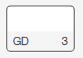            | 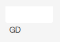 | 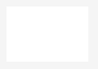 |
| **summary**                  | Complete node structure and controls.           | Node structure without edit controls or hover-drag root. | Node with labels and connection label; analytics text omitted. | Node background, analytics area, and label.         | Interaction, dockable, and analytics areas only.    |
| **visual elements**          | `makeNodeLODFull`                               | `makeNodeLODLevel3`                                      | `makeNodeLODLevel2`                                            | `makeNodeLODLevel1`                                 | `makeNodeLODLevel0`                                 |
| `makeNodeHoverRoot`          | ✓                                               | ✓                                                        | ✓                                                              | ✓                                                   | ✓                                                   |
| `makeNodeRoot`               | ✓                                               | ✓                                                        | ✓                                                              |                                                     |                                                     |
| `makeBackground`             | ✓                                               | ✓                                                        | ✓                                                              | ✓                                                   |                                                     |
| `makeLabelArea`              | ✓                                               | ✓                                                        | ✓                                                              |                                                     |                                                     |
| `makeHoverDragBackground`    | ✓                                               | ✓                                                        | ✓                                                              | ✓                                                   | ✓                                                   |
| `makeHoverDragRoot`          | ✓                                               |                                                          |                                                                |                                                     |                                                     |
| `makeEditButtonBackground`   | ✓                                               |                                                          |                                                                |                                                     |                                                     |
| `makeEditButton`             | ✓                                               |                                                          |                                                                |                                                     |                                                     |
| `makeNodeDockable`           | ✓                                               | ✓                                                        | ✓                                                              | ✓                                                   | ✓                                                   |
| `makeAnalyticsArea`          | ✓                                               | ✓                                                        | ✓                                                              | ✓                                                   | ✓                                                   |
| `makeAnalyticsTextLeftArea`  | ✓                                               | ✓                                                        |                                                                |                                                     |                                                     |
| `makeAnalyticsTextRightArea` | ✓                                               | ✓                                                        |                                                                |                                                     |                                                     |
| `makeLabelText`              | ✓                                               | ✓                                                        | ✓                                                              | ✓                                                   |                                                     |
| `makeLabelConnectionText`    | ✓                                               | ✓                                                        | ✓                                                              |                                                     |                                                     |

### Notes

| **Notes**                    | `FULL` (`>= 50%`)                                | `LEVEL3` (`>= 40%`, `< 50%`)                        | `LEVEL2` (`>= 30%`, `< 40%`)                        | `LEVEL1` (`>= 20%`, `< 30%`)                        | `LEVEL0` (`< 20%`)                                  |
| ---------------------------- | ------------------------------------------------ | --------------------------------------------------- | --------------------------------------------------- | --------------------------------------------------- | --------------------------------------------------- |
| **screenshot**               | 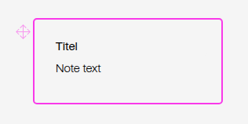  | 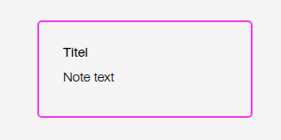 | 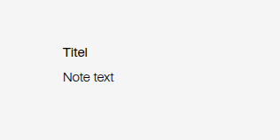 | 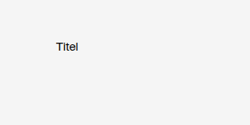 |  |
| **summary**                  | Complete note structure and editing affordances. | Note structure without drag affordances.            | Note root and text only.                            | Note root and title only.                           | Same note root and title as `LEVEL1`.               |
| **visual elements**          | `makeNoteLODFull`                                | `makeNoteLODLevel3`                                 | `makeNoteLODLevel2`                                 | `makeNoteLODLevel1`                                 | `makeNoteLODLevel0`                                 |
| `makeNoteHoverRoot`          | ✓                                                | ✓                                                   |                                                     |                                                     |                                                     |
| `makeNoteRoot`               | ✓                                                | ✓                                                   | ✓                                                   | ✓                                                   | ✓                                                   |
| `makeNoteTitleArea`          | ✓                                                | ✓                                                   |                                                     |                                                     |                                                     |
| `makeNoteTextArea`           | ✓                                                | ✓                                                   |                                                     |                                                     |                                                     |
| `makeNoteTitleAreaText`      | ✓                                                | ✓                                                   | ✓                                                   | ✓                                                   | ✓                                                   |
| `makeNoteText`               | ✓                                                | ✓                                                   | ✓                                                   |                                                     |                                                     |
| `makeNoteDragAreaBackground` | ✓                                                |                                                     |                                                     |                                                     |                                                     |
| `makeNoteDragArea`           | ✓                                                |                                                     |                                                     |                                                     |                                                     |

### Trainrun Sections

For trainrun-section methods,
`regular` and `filtered` identify the endpoint rendering path.

Trainrun sections have a separate method for filtered endpoint nodes. Both
regular and filtered-endpoint method names are listed in the Trainrun Sections
column. `LEVEL0` delegates to the `LEVEL1` filtered-endpoint method.

This behavior is implemented by `renderTrainrunSectionObjectWithFilteredEndpointNodes`
and its `makeTrainrunSection...WithFilteredEndpointNodes` methods in
[`trainrunsections.view.ts`](../src/app/view/editor-main-view/data-views/trainrunsections.view.ts).

| **Trainrun Sections**                          | `FULL` (`>= 50%`)                                                       | `LEVEL3` (`>= 40%`, `< 50%`)                                                | `LEVEL2` (`>= 30%`, `< 40%`)                                                | `LEVEL1` (`>= 20%`, `< 30%`)                                                | `LEVEL0` (`< 20%`)                                                          |
| ---------------------------------------------- | ----------------------------------------------------------------------- | --------------------------------------------------------------------------- | --------------------------------------------------------------------------- | --------------------------------------------------------------------------- | --------------------------------------------------------------------------- |
| **screenshot**                                 | 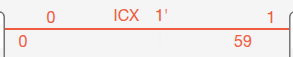 |  | 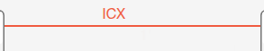 | 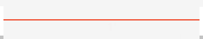 | 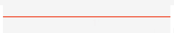 |
| **summary**                                    | Full details; includes filtered-endpoint variant.                       | Details without text backgrounds; includes filtered-endpoint variant.       | Section name and endpoint symbols; includes filtered-endpoint variant.      | Base path; filtered endpoint variant adds goto information.                 | Base path; filtered endpoint variant delegates to `LEVEL1`.                 |
| **visual elements — regular**                  | `makeTrainrunSectionLODFull`                                            | `makeTrainrunSectionLODLevel3`                                              | `makeTrainrunSectionLODLevel2`                                              | `makeTrainrunSectionLODLevel1` (empty)                                      | `makeTrainrunSectionLODLevel0` (empty)                                      |
| **visual elements — filtered endpoints**       | `makeTrainrunSectionLODFullWithFilteredEndpointNodes`                   | `makeTrainrunSectionLODLevel3WithFilteredEndpointNodes`                     | `makeTrainrunSectionLODLevel2WithFilteredEndpointNodes`                     | `makeTrainrunSectionLODLevel1WithFilteredEndpointNodes`                     | `makeTrainrunSectionLODLevel0WithFilteredEndpointNodes`                     |
| `makeTrainrunSectionPath` (common)             | ✓                                                                       | ✓                                                                           | ✓                                                                           | ✓                                                                           | ✓                                                                           |
| `makeTrainrunSectionDirectionArrows` (common)  | ✓                                                                       | ✓                                                                           | ✓                                                                           | ✓                                                                           | ✓                                                                           |
| `makeTrainrunSectionAsymmetrySymbols` (common) | ✓                                                                       | ✓                                                                           | ✓                                                                           | ✓                                                                           | ✓                                                                           |
| `makeTrainrunSectionSourcePin`                 | regular                                                                 | regular                                                                     | regular                                                                     |                                                                             |                                                                             |
| `makeTrainrunSectionTargetPin`                 | regular                                                                 | regular                                                                     | regular                                                                     |                                                                             |                                                                             |
| `makeTrainrunSectionTextBackground`            | regular + filtered                                                      |                                                                             |                                                                             |                                                                             |                                                                             |
| `makeTrainrunSectionText`                      | regular + filtered                                                      | regular + filtered                                                          | regular                                                                     |                                                                             |                                                                             |
| `makeTrainrunSectionTargetSemicircle`          | regular + filtered                                                      | regular + filtered                                                          | regular + filtered                                                          |                                                                             |                                                                             |
| `makeTrainrunSectionSourceSemicircle`          | regular + filtered                                                      | regular + filtered                                                          | regular + filtered                                                          |                                                                             |                                                                             |
| `makeTrainrunSectionIntermediateStops`         | regular                                                                 | regular                                                                     |                                                                             |                                                                             |                                                                             |
| `makeTrainrunSectionSourceGotoInfo`            | filtered                                                                | filtered                                                                    | filtered                                                                    | filtered                                                                    | filtered                                                                    |
| `makeTrainrunSectionTargetGotoInfo`            | filtered                                                                | filtered                                                                    | filtered                                                                    | filtered                                                                    | filtered                                                                    |

### Connections

| **Connections**         | `FULL` (`>= 50%`)       | `LEVEL3` (`>= 40%`, `< 50%`) | `LEVEL2` (`>= 30%`, `< 40%`) | `LEVEL1` (`>= 20%`, `< 30%`) | `LEVEL0` (`< 20%`)                |
| ----------------------- | ----------------------- | ---------------------------- | ---------------------------- | ---------------------------- | --------------------------------- |
| **summary**             | Curve and pins.         | Curve and pins.              | Curve only.                  | Curve only.                  | No connection visuals.            |
| **visual elements**     | `makeConnectionLODFull` | `makeConnectionLODLevel3`    | `makeConnectionLODLevel2`    | `makeConnectionLODLevel1`    | `makeConnectionLODLevel0` (empty) |
| `createConnectionCurve` | ✓                       | ✓                            | ✓                            | ✓                            |                                   |
| `createConnectionPins`  | ✓                       | ✓                            |                              |                              |                                   |
